# ⚡ Awesome AI Coding Agent Optimization

  

  
  
  
  
  

---

## 🚀 Overview & Ecosystem

A curated directory of **AI Coding Agent Optimization** tools, SaaS platforms, and open-source frameworks. This list focuses on maximizing agent efficiency, slashing token consumption, reducing context costs, enforcing minimal diffs, eliminating over-engineering (YAGNI), and steering autonomous coding workflows toward lean, production-grade output.

> **Last updated:** October 2026

---

## 📑 Table of Contents

- [🌐 Sector Overview & Market Dynamics](#-sector-overview--market-dynamics)
- [💼 SaaS/Hosted Platforms](#-saashosted-platforms)
- [🔓 Open-Source GitHub Projects](#-open-source-github-projects)
- [🛠️ Optimization Techniques & Best Practices](#️-optimization-techniques--best-practices)
- [🤝 How to Contribute](#-how-to-contribute)
- [💖 Support & Sponsor](#-support--sponsor)
- [⭐ Star History](#-star-history)
- [📜 Disclaimer](#-disclaimer)

---

## 🌐 Sector Overview & Market Dynamics

The global AI developer tools and coding agents market has surged from an estimated **$5.5 billion in 2024 to over $18+ billion in 2026**, driven by widespread developer adoption of agentic IDEs, autonomous refactoring pipelines, and multi-file reasoning assistants. The sector currently exhibits **moderate fragmentation with strong consolidation tailwinds**: while big tech incumbents (Microsoft/GitHub Copilot, Amazon Q) and category-defining leaders (Cursor, Codeium/Windsurf) capture substantial enterprise volume through distribution moats, the ecosystem remains dynamic with innovative startups and open-source middleware layers capturing significant market share around cost efficiency, local LLM execution, and token-saving agent behaviors.

---

## 💼 SaaS/Hosted Platforms

| Product | Description | Pricing (Starting Paid Tier) | Free Tier Limits / Trial | Company Size (Valuation / Revenue) |
| :--- | :--- | :--- | :--- | :--- |
| **[Amazon Q Developer](https://aws.amazon.com/q/developer/)** | AWS AI coding companion with code generation, explanation, and agent capabilities tuned for cloud and enterprise development efficiency. | $19 / user / month (Pro Tier) | Free forever: 50 agentic/chat requests/mo, 1,000 LOC code transformations/mo, 50 security scans/mo (via AWS Builder ID) | ~$2.0T+ Market Cap (Amazon/AWS parent) |
| **[GitHub Copilot Enterprise](https://github.com/features/copilot)** | Enterprise Copilot experience with organization-wide context, policy controls, and features aimed at productive, high-quality agent-assisted coding. | $39 / user / month (Copilot Enterprise; requires GitHub Enterprise Cloud) | Free plan: 2,000 code completions/mo & 50 chat requests/mo | ~$3.1T+ Market Cap (Microsoft parent; GitHub >$1B+ ARR) |
| **[Cursor](https://cursor.com/)** | AI-first code editor with strong codebase indexing and agentic workflows optimized for multi-step coding tasks and large context windows. | $20 / month (Pro Tier) | Free Hobby tier: 2,000 tab completions/mo, 50 slow premium requests/mo; 14-day Pro trial included | $29.3B Valuation (acquired by SpaceX for $60B; >$1B ARR) |
| **[JetBrains AI](https://www.jetbrains.com/ai/)** | AI features inside JetBrains IDEs focused on smart completion, explanation, and efficient developer workflows. | $10 / month (AI Pro) | AI Free tier: 3 AI cloud credits every 30 days, unlimited local model code completion; 30-day Pro trial | ~$7.0B Valuation (~$710M Annual Revenue) |
| **[Sourcegraph Cody](https://sourcegraph.com/cody)** | Code-aware AI assistant from Sourcegraph that leverages large-scale code search for precise, context-efficient answers and edits. | $16,000 / year (Enterprise minimum contract) | 14-day customized enterprise proof-of-concept / evaluation upon sales request (retired individual free tier had 200 chats/mo) | $2.6B Valuation (~$50M ARR) |
| **[Codeium](https://codeium.com/)** | Fast AI coding platform focused on low-latency generation and efficient assistance across IDEs and agent-style experiences. | $15 / month (Pro Tier) | Free forever: unlimited tab completions, basic in-editor chat, limited Cascade flow actions | $1.25B - $2.85B Valuation (~$80M ARR) |
| **[Windsurf (Codeium)](https://codeium.com/windsurf)** | Agentic IDE experience designed for multi-step coding tasks with an emphasis on practical, efficient agent behavior. | $20 / month (Pro Tier) | Free tier: unlimited tab autocompletions, 25 Cascade Flow Actions/mo, 16K token context window | $1.25B - $2.85B Valuation (Part of Codeium; ~$80M ARR) |
| **[Augment Code](https://www.augmentcode.com/)** | AI coding platform emphasizing deep codebase context and high-quality, efficient assistance for professional developers. | $20 / month (Indie Tier; 40,000 credits) | 14-day free trial with 30,000 credits (no permanent free tier) | $977M Valuation ($252M+ Total Funding) |
| **[Supermaven Enterprise](https://supermaven.com/)** | High-speed AI coding assistant optimized for low latency and efficient completions in professional environments. | $10 / user / month (Pro Tier) | Free forever: basic low-latency completions (excludes 1M token context & $5 chat credits); 7-day Pro trial | Acquired by Cursor/Anysphere (Parent valued at $29.3B; $12M prior funding) |
| **[Tabnine Enterprise](https://www.tabnine.com/)** | Privacy-oriented AI coding assistant with private models and enterprise controls for efficient, compliant code generation. | $12 / user / month (Pro Tier, annual billing) | Free Basic tier: short single-line code completions & limited chat rate; 14-day Pro trial | ~$100M+ Funding (~$27M Annual Revenue) |

---

## 🔓 Open-Source GitHub Projects

Curated open-source coding agents, efficiency middleware, and agent runtime frameworks, sorted in descending order by GitHub stars:

1. **[OpenCode](https://github.com/anomalyco/opencode)**   
   The open-source coding agent designed for terminal and desktop workflows; connects natively to any model provider and works seamlessly with efficiency-oriented rulesets.

2. **[AutoGPT](https://github.com/Significant-Gravitas/AutoGPT)**   
   Pioneering autonomous AI agent framework capable of executing multi-step coding, engineering workflows, and system-level task chains.

3. **[Ponytail](https://github.com/DietrichGebert/ponytail)**   
   Middleware and agent behavior layer that pushes coding agents toward maximal efficiency — “makes your AI agent think like the laziest senior dev,” slashing token usage, diff size, and execution costs.

4. **[OpenHands](https://github.com/OpenHands/OpenHands)**   
   Open-source platform for autonomous software development agents that build, refactor, and test software inside controlled sandboxed environments.

5. **[MetaGPT](https://github.com/geekan/MetaGPT)**   
   Multi-agent collaborative framework that simulates an entire software company (Product Managers, Architects, Project Managers, Engineers) with Standard Operating Procedures (SOPs) to generate complete codebases.

6. **[Cline](https://github.com/cline/cline)**   
   Autonomous coding agent inside VS Code featuring human-in-the-loop approval gates, command execution, and granular file diff inspections.

7. **[Open Interpreter](https://github.com/OpenInterpreter/open-interpreter)**   
   Natural language interface for running code locally on your machine, orchestrating complex terminal commands, scripts, and local model inference.

8. **[Aider](https://github.com/Aider-AI/aider)**   
   Terminal-first AI pair programming tool that builds concise codebase repository maps and generates clean, git-native, minimal commits.

9. **[Continue](https://github.com/continuedev/continue)**   
   Leading open-source autopilot extension for VS Code and JetBrains, allowing developers to connect custom models, local LLMs (Ollama), and team-wide coding rules.

10. **[GPT Pilot](https://github.com/Pythagora-io/gpt-pilot)**   
    Dev-tool agent that collaborates with developers step-by-step to write entire production apps from scratch while iteratively testing and fixing code.

11. **[Roo Code](https://github.com/RooVetGit/Roo-Code)**   
    AI pair programmer and agentic VS Code extension with custom personas, mode-switching (Architect, Code, Ask), and fine-grained token controls.

12. **[SWE-agent](https://github.com/SWE-agent/SWE-agent)**   
    State-of-the-art research agent from Princeton NLP designed specifically to solve end-to-end GitHub issues autonomously on the SWE-bench benchmark.

13. **[Sweep](https://github.com/sweepai/sweep)**   
    AI junior developer that automatically turns bug reports and feature requests into small, clean, test-passing pull requests.

---

## 🛠️ Optimization Techniques & Best Practices

- **Minimal Diffs & YAGNI Enforcement**: Use behavior middleware like **Ponytail** or strict system prompts to prevent agents from refactoring unrelated modules or over-engineering solutions.
- **Repository Mapping**: Pre-compute ASTs and symbol trees (as seen in **Aider**) to avoid feeding multi-thousand token raw files into the LLM context window.
- **Local Model Routing**: Route repetitive tasks, code completions, and simple unit tests to local engines (Ollama, vLLM, llama.cpp) while reserving frontier models for architectural decisions.
- **Approval Gates & Sandboxed Runtimes**: Use containerized runners (e.g., Docker in **OpenHands**) to execute and verify agent test results without polluting local environments.

---

## 🤝 How to Contribute

Contributions are warmly welcomed! Please follow these steps:

1. 🍴 **Fork** the repository.
2. 📝 **Add/edit** entries in `README.md` following the existing format.
3. 🔗 **Include**: Tool name, official link, 1–2 sentence description, pricing/star details, and whether it is SaaS or open-source.
4. 🚀 **Submit a Pull Request** with a concise description of your changes.

---

## 💖 Support & Sponsor

If you find this repository helpful for optimizing your developer workflows or exploring the AI coding ecosystem, please consider supporting the project:

- ⭐ **Star this repository** to help others discover it!
- 🍴 **Fork it** and build your own tailored agent stacks.
- 📢 **Share** it with your engineering team, developer communities, and on social media.
- ☕ **Buy me a coffee**: If you'd like to sponsor continued maintenance, research, and updates, you can sponsor directly via the [GitHub Sponsor Dashboard](https://github.com/sponsors/ishandutta2007). Your support is deeply appreciated! ❤️

---

## ⭐ Star History

---

## 📜 Disclaimer

- This is a **community-curated** list for informational and educational purposes only. Mention of any product or service does not constitute an official endorsement.
- Optimized coding agents can still hallucinate or produce faulty code. Always review diffs, run test suites, and audit costs and token consumption in production environments.

---

  <b>Built with ❤️ for developers, engineering teams, and AI agent builders worldwide.</b> 
  Let's make AI coding agents faster, leaner, and more cost-efficient!

